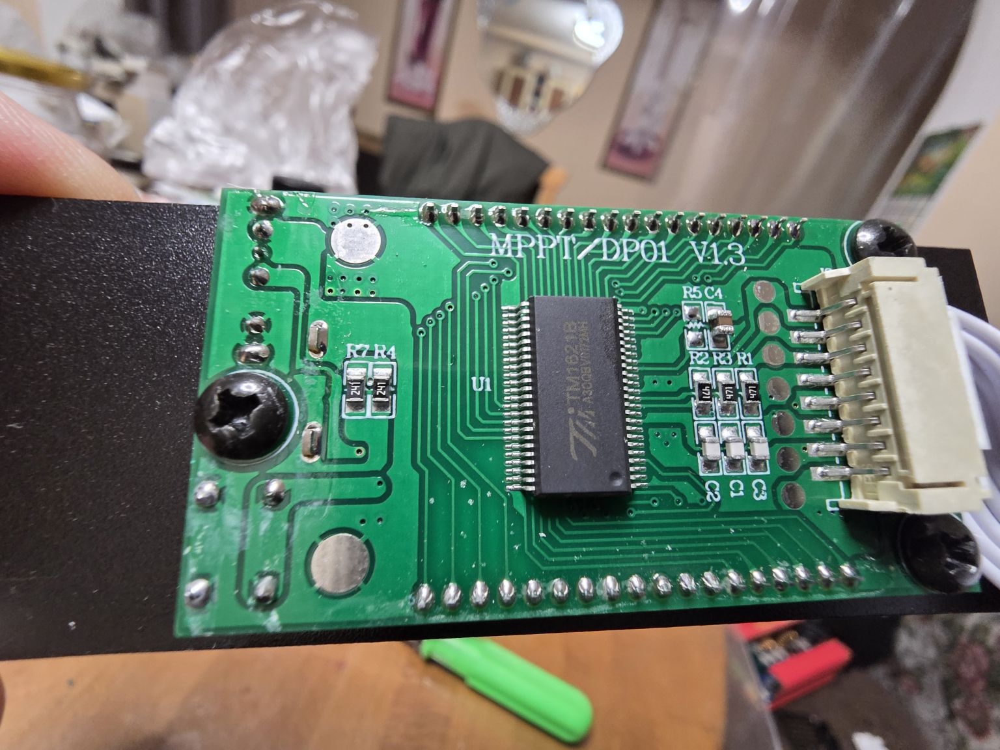

# SBC1200R MPPT: исследование UART и подключение к Home Assistant

Reverse engineering of the SBC1200R boost solar charge controller: passive UART captures, a documented telemetry frame, and ESPHome configurations for ESP8266 DevKit (default) and AI-Thinker ESP32-CAM. **Working receive settings: 4800 baud, 8N1, no flow control. No controller commands are known or transmitted.**

Исследование одного экземпляра **SBC1200R**, выполненное 23 ноября 2026 года. Название и номиналы взяты с наклейки; электрические характеристики устройства независимо не проверялись.



## Что удалось установить

- С J9.2 идёт непрерывная UART-телеметрия, примерно 4 пакета в секунду.
- Рабочие настройки приёма: **4800, 8N1**, без управления потоком.
- Наблюдаемый пакет — 12 байт: `FE FE FE FE 07 Vout_L Vout_H Iout_L Iout_H Vin_L Vin_H SUM`.
- Напряжения и ток представлены как `uint16 little-endian / 100`.
- Последний байт равен сумме шести байтов измерений по модулю 256.
- Выходная мощность вычисляется как `Vout × Iout`; отдельное поле мощности не найдено.
- В трёх основных записях получено **600 полных пакетов, все с совпавшей контрольной суммой**.

Два напряжения сопоставлены с дисплеем. Масштаб тока поддерживается показанием около 2,8 А; отнесение тока к выходу — совпадением расчётной мощности около 187 Вт с показанием около 186 Вт. Показания дисплея сообщались асинхронно и не привязаны к конкретному кадру. Независимой поверки мультиметром под нагрузкой не проводилось.

## Что пока неизвестно

- Назначение J9.4 как RX **не подтверждено**; команды чтения и управления неизвестны.
- Не найдены отдельные поля температуры и штатного счётчика кВт·ч.
- Байт `07` похож на длину последующих данных с контрольной суммой, но записаны только пакеты с этим значением.
- Один стоповый бит обеспечивает приём; 8N2 тоже принимал поток, поэтому точное число передаваемых стоповых битов не установлено.
- ESP8266 прошита 24 ноября 2026 года; Wi-Fi и Native API проверены. Приём с MPPT через CJMCU ещё не проверен: при проверке плата была подключена только по USB.

## Документация

- [Формат протокола и уровень уверенности](docs/protocol.md)
- [Аппаратная часть, J9 и подключение](docs/hardware.md)
- [ESPHome и Home Assistant](docs/home-assistant.md)
- [Ход исследования и найденные источники](docs/research.md)
- [Каталог дампов и ограничения измерений](captures/README.md)

## Быстрый разбор дампа

Python 3.10+; для разбора файлов дополнительные библиотеки не нужны:

```sh
python tools/mppt_uart.py decode captures/20261123_180104_loaded/loaded_4800_8N1.bin --output readings.csv
python -m unittest discover -s tests -v
```

Пассивная запись своего контроллера требует `pyserial`:

```sh
python -m pip install -r requirements.txt
python tools/mppt_uart.py capture --port COM7 --seconds 60 --output capture.bin
```

Для Linux укажи соответствующий порт, например `/dev/ttyUSB0`. Скрипт не отправляет байты, отключает управление потоком и задаёт DTR/RTS false перед открытием порта. Это не исключает кратких переходов на управляющих линиях со стороны драйвера; физически подключать их к MPPT не требуется.

## Подключение к ESP8266 DevKit

Основная конфигурация рассчитана на **NodeMCU v2 / ESP-12E (4 MB)**. Приём назначен на **D7 / GPIO13**, аппаратный UART0 в переключённом режиме; последовательные логи отключены. Для ESP32-CAM сохранён [отдельный вариант](esphome/sbc1200r-esp32cam.yaml).

По фотографии уточнён вариант CJMCU: в каждой секции Chan1/Chan2 есть транзисторный путь **TXO↔TXI** и резистивный **RXI→RXO**. Для MPPT выбран транзисторный путь Chan1: верхний левый TXO и нижний левый TXI на фотографии владельца.

| CJMCU | Подключение |
|---|---|
| HV | J9.1, +5 В контроллера |
| LV | 3V3 ESP8266 |
| GND | J9.3 и GND ESP8266 |
| TXO, сторона HV | J9.2, TX контроллера |
| TXI, сторона LV | D7 / GPIO13 ESP8266 |

HV и LV — выводы питания/опорных уровней. TXO/TXI — двунаправленный транзисторный путь, поэтому в нашем направлении сигнал входит в TXO и выходит из TXI. Внешний делитель не нужен. Прежние обозначения HV1/LV1 относились к другой разновидности модуля и к показанной плате не применяются.

На сигнальной линии измерено около 4,7–5 В; напрямую к GPIO ESP8266/ESP32 её подключать нельзя. Сначала нужно проверить допустимость общей земли с питанием установки и компьютером; при необходимости использовать гальваническую развязку. ESP8266 DevKit первоначально питается от отдельного стабильного источника 5 В. J9.1 в этой схеме питает только высоковольтную сторону преобразователя уровней. Запас тока внутреннего питания MPPT для самой ESP8266 не исследован.

Готовая [конфигурация](esphome/sbc1200r.yaml) публикует два напряжения, выходной ток, расчётную мощность и состояние UART. На `http://sbc1200r.local/` доступны веб-интерфейс и текущие логи. Основная Wi-Fi сеть задаётся wifi_ssid/wifi_password, резервная — wifi_ssid_home/wifi_password_home. Она содержит ссылки на Wi-Fi secrets, но не сами пароли. Собранные прошивки намеренно не публикуются: они могут содержать сетевые реквизиты владельца.

## Фотографии

[Основная плата](photos/main-board.jpg), [драйвер дисплея](photos/lcd-board-tm1621b.jpg), [стабилизатор 5 В](photos/regulator-5v.jpg), [силовая часть](photos/power-section.jpg), [узел питания](photos/power-converter.jpg).

Это экспериментальные результаты для конкретного экземпляра, а не документация производителя. Перенос на другие ревизии требует проверки распиновки, уровней сигналов и формата пакетов.
